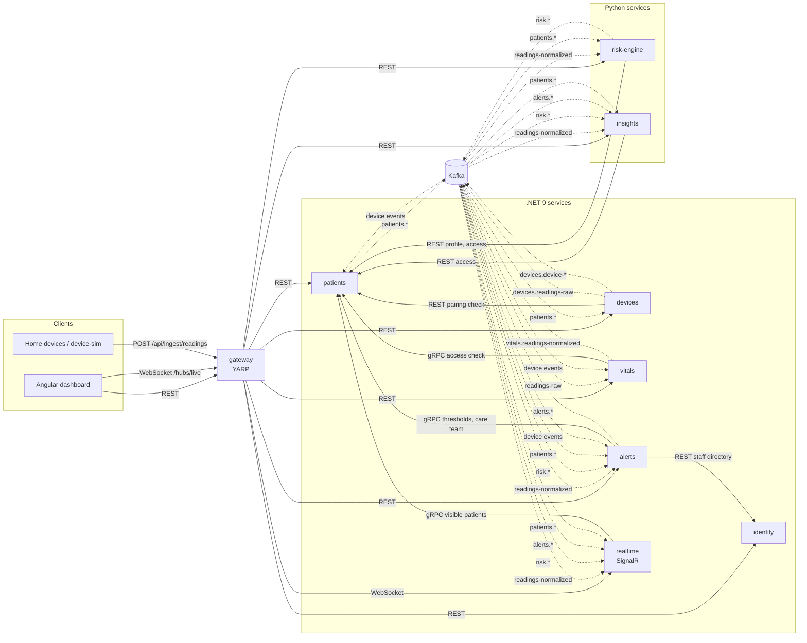

# Architecture

remote-health-watch is a set of small services around one idea: device readings are an append-only stream keyed by patient, and
everything else (scores, alerts, dashboards, reports) is a consumer of that stream. Services own their data, talk
synchronously only where a user is waiting for an answer, and otherwise react to events on Kafka.

> Demo system with synthetic data. It is not a medical device.

## System overview

Solid arrows are synchronous calls (REST, gRPC, WebSocket); dashed arrows are Kafka topics.



## Services

| Service | Language | Store | Responsibility |
|---|---|---|---|
| `gateway` | .NET (YARP) | none | Single entry point. JWT validation, routing, per-device token bucket and per-user rate limits, WebSocket forwarding to `realtime`, and the patient overview composition endpoint. |
| `identity` | .NET | SQL Server `rhw_identity` | Staff accounts and roles (ASP.NET Core Identity), short-lived JWT access tokens, rotating refresh tokens with reuse detection. |
| `patients` | .NET | SQL Server `rhw_patients` | Enrollment, monitoring plans, personal thresholds, care teams, PHI audit log. gRPC `PatientDirectory` server. Owns the enrollment saga state. |
| `devices` | .NET | SQL Server `rhw_devices`, Redis | Device registry, hashed API keys with rotation and revocation, pairing, the ingestion endpoint, last-seen and silent-device detection. |
| `vitals` | .NET | SQL Server `rhw_vitals` (columnstore), Redis | Consumes raw readings, dedupes, normalises units, stores, maintains 1-minute and 1-hour rollups and the latest snapshot, serves trend queries. |
| `alerts` | .NET | SQL Server `rhw_alerts` (incl. Quartz job store) | Threshold rules, alert lifecycle, dedup and suppression, the escalation process manager, email and SMS, daily digest. |
| `realtime` | .NET | Redis (SignalR backplane) | The `/hubs/live` hub. Pushes vitals, scores and alert lifecycle events to care-team groups. |
| `risk-engine` | Python | SQL Server `rhw_risk` | NEWS2 over a rolling window, per-patient baselines, z-score and IsolationForest anomalies, deterioration trend. |
| `insights` | Python | SQL Server `rhw_insights`, Azurite / Blob Storage | Programme KPIs and weekly per-patient PDF reports (claim check). |

## Data ownership

Every service has its own database and its own SQL login, created by `deploy/sqlserver/init.sql`. A login is `db_owner`
of exactly one database, so a service can run its own migrations but cannot read another service's tables. Locally all
seven databases live in one SQL Server 2022 container; in Azure they are separate databases on one logical server.

| Data | Owner | Others get it via |
|---|---|---|
| Staff, roles, refresh tokens | identity | JWT claims; `/api/users/directory` for services |
| Patient demographics, conditions, plans | patients | REST/gRPC lookups; events carry surrogate ids only |
| Thresholds, care teams | patients | gRPC `GetThresholds`, `GetCareTeam` (cached), invalidated by events |
| PHI audit log | patients | `AuthorizeAccess` RPC and `/internal/access` write to it |
| Device registry, keys, last seen | devices | `devices.device-*` events |
| Raw readings, rollups, latest snapshot | vitals | `vitals.readings-normalized`, trend/latest APIs |
| Scores, baselines, anomalies | risk-engine | `risk.*` events, `/api/risk/*` |
| Alerts, timeline, notes, timers | alerts | `alerts.*` events, `/api/alerts/*` |
| KPI facts, report index, PDFs | insights | `/api/insights/*`, `insights.report-generated` |

Patient names and dates of birth never leave `patients`. Kafka keys and payloads use the surrogate `patientId` GUID.

## Topic catalog

Topics are created by `deploy/kafka/create-topics.sh` from `deploy/kafka/topics.txt`. Every topic also gets a
`.retry` lane (same partition count) and a `.dlq` lane (one partition). Auto-creation is disabled on the broker.

| Topic | Key | Partitions | Producer | Consumers |
|---|---|---|---|---|
| `devices.readings-raw` | patientId | 12 | devices (direct produce) | vitals |
| `vitals.readings-normalized` | patientId | 12 | vitals (outbox) | risk-engine, alerts, realtime, insights |
| `devices.device-paired` | patientId | 6 | devices (outbox) | patients, vitals, alerts |
| `devices.device-unpaired` | patientId | 6 | devices (outbox) | patients, vitals, alerts |
| `devices.device-pairing-failed` | patientId | 6 | devices (outbox) | patients, alerts |
| `devices.device-silent` | patientId | 6 | devices (outbox) | vitals, alerts |
| `patients.patient-enrolled` | patientId | 6 | patients (outbox) | devices, risk-engine, insights |
| `patients.thresholds-changed` | patientId | 6 | patients (outbox) | alerts, risk-engine |
| `patients.care-team-changed` | patientId | 6 | patients (outbox) | alerts, realtime |
| `patients.patient-discharged` | patientId | 6 | patients (outbox) | devices, alerts, risk-engine, insights |
| `patients.monitoring-status-changed` | patientId | 6 | patients (outbox) | (dashboard history, future use) |
| `risk.score-updated` | patientId | 6 | risk-engine (outbox) | alerts, realtime, insights |
| `risk.anomaly-detected` | patientId | 6 | risk-engine (outbox) | alerts, realtime |
| `risk.deterioration-trend` | patientId | 6 | risk-engine (outbox) | alerts, realtime |
| `alerts.alert-raised` | patientId | 6 | alerts (outbox) | realtime, insights |
| `alerts.acknowledged` | patientId | 6 | alerts (outbox) | realtime, insights |
| `alerts.escalated` | patientId | 6 | alerts (outbox) | realtime, insights |
| `alerts.resolved` | patientId | 6 | alerts (outbox) | realtime, insights |
| `insights.report-generated` | patientId | 3 | insights (outbox) | (notification hook) |

Every message is a schema-versioned JSON envelope (`src/shared/RemoteHealthWatch.Contracts/Events/EventEnvelope.cs`):

```json
{
  "id": "5d2e4c1a-8a8e-4c55-9a43-3d5f0d9b8a10",
  "type": "risk.score-updated",
  "schemaVersion": 1,
  "occurredAt": "2025-06-12T09:41:07.512+00:00",
  "source": "risk-engine",
  "data": {
    "patientId": "8c1d7a52-3b1e-4f6a-9a0e-2a1b3c4d5e6f",
    "score": 7,
    "band": "High",
    "previousBand": "Medium",
    "components": { "RespiratoryRate": 3, "SpO2": 2, "AirOrOxygen": 0, "Systolic": 0, "Pulse": 2, "Consciousness": 0, "Temperature": 0 },
    "computedAt": "2025-06-12T09:41:07.498+00:00"
  }
}
```

Headers carry `event-id`, `event-type` and a W3C `traceparent`, so a trace started by a device upload continues
through vitals, the risk engine, alerts and the SignalR push.

## Why this shape

- **Readings never block on business logic.** The ingestion endpoint validates, authenticates and produces. If the
  risk engine is slow or down, readings are still stored and the dashboard still updates; scores catch up from the log.
- **Ordering where it matters, parallelism everywhere else.** Keying by patient keeps one patient's readings ordered on
  one partition, while 12 partitions let up to 12 `vitals` replicas share the load.
- **Synchronous calls only on user paths and hot-path lookups.** The gRPC directory is cached (HybridCache) and
  invalidated by events, so a patients outage degrades alerts gracefully instead of stopping them.
- **Python where the libraries are.** NEWS2 is simple arithmetic, but anomaly detection and PDF rendering lean on
  numpy, scikit-learn and ReportLab. The Python services speak the same envelope format and the same JWTs.
