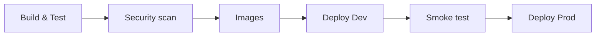

# Deployment

## Docker Compose

`compose.yaml` at the root includes `deploy/docker-compose.yml` and `deploy/docker-compose.override.yml` and reads the
root `.env`.

```bash
cp .env.example .env
docker compose up --build
```

Start order is handled by health checks: SQL Server → `sqlserver-init` (databases and logins) → Kafka → `kafka-init`
(topics) → services → `seed` (one-shot) → `device-sim`.

| URL | What |
|---|---|
| http://localhost:4200 | dashboard (nginx proxies `/api` and `/hubs` to the gateway) |
| http://localhost:5000 | gateway (`GATEWAY_PORT` to change; macOS AirPlay Receiver also uses 5000) |
| http://localhost:8085 | Kafka UI |
| http://localhost:8025 | MailHog |
| http://localhost:16686 | Jaeger |

Useful operations:

```bash
docker compose up -d --scale vitals=3 --no-recreate vitals        # competing consumers
SIM_DEVICES=60 SIM_INTERVAL_SECONDS=2 docker compose up -d device-sim
docker compose logs -f device-sim                                  # readings/s every 30 s
docker compose down                                                # keep volumes
docker compose down -v                                             # also drop data (SQL, Kafka, seeded keys)
```

Validate without starting anything:

```bash
docker compose -f deploy/docker-compose.yml config -q
```

Images: .NET services build from the repo root with `mcr.microsoft.com/dotnet/sdk:9.0.301-bookworm-slim` and run on
`mcr.microsoft.com/dotnet/aspnet:9.0.6-bookworm-slim` as the non-root `app` user. Python services run on
`python:3.13.3-slim-bookworm` with Microsoft ODBC Driver 18 as uid 10001. The dashboard is built on `node:22.14.0-alpine`
and served by `nginx:1.27.5-alpine`.

## Kubernetes (Kustomize)

```
deploy/k8s/
├── base/                 Deployments, Services, PDBs, ConfigMap, Secret (placeholders), HPA, NetworkPolicies, Ingress
├── overlays/dev/         namespace remote-health-watch-dev, 1 replica each, in-cluster Kafka/SQL/Redis/Azurite/MailHog/Jaeger
├── overlays/prod/        namespace remote-health-watch, ACR images, Azure endpoints, more replicas, zone spreading, TLS
└── optional/             KEDA ScaledObject for vitals
```

Render and inspect:

```bash
kubectl kustomize deploy/k8s/overlays/dev  | less
kubectl kustomize deploy/k8s/overlays/prod | less
```

**Base.** Every Deployment has startup (`/alive`), liveness (`/alive`) and readiness (`/health`) probes, requests and
limits, a non-root security context and a PodDisruptionBudget. `vitals` and `devices` have CPU-based HPAs (vitals
2–12, devices 1–6). `default-deny-ingress` blocks everything; the ingress controller may reach only the gateway and the
frontend, the gateway may reach every service, and the services may reach patients and identity for lookups. The
Ingress routes `/api` and `/hubs` to the gateway and `/` to the frontend, with long WebSocket timeouts and cookie
affinity for SignalR.

**Dev overlay.** Runs on kind or Docker Desktop. Brings its own Kafka (KRaft), SQL Server, Redis, Azurite, MailHog and
Jaeger, a Job that creates the topics and one that creates the per-service databases and logins, and a policy letting
pods in the namespace reach those dependencies. `ASPNETCORE_ENVIRONMENT=Development` so services migrate and identity
seeds the demo staff. Kustomize can't read files outside the overlay, so `overlays/dev/files/` holds copies of the topic
catalog and SQL script; the pipeline fails if they drift.

```bash
docker compose build                                   # images tagged remote-health-watch/*:dev
kind create cluster && kind load docker-image remote-health-watch/gateway:dev ...   # or use Docker Desktop's cluster
kubectl apply -k deploy/k8s/overlays/dev
kubectl -n remote-health-watch-dev get pods -w
```

**Prod overlay.** Targets AKS with managed services: Event Hubs' Kafka endpoint, Azure Cache for Redis, Azure SQL and
Blob Storage. Image names point at `remotehealthwatchacr.azurecr.io`; the pipeline pins tags at deploy time. Secrets are meant
to come from Key Vault through the Secrets Store CSI driver; the generated secret in the base only exists so the overlay
renders. Production runs with `ASPNETCORE_ENVIRONMENT=Production`, so migrations are applied as a release step (EF
migration bundles and `alembic upgrade head`) rather than by every pod; alerts still creates its Quartz tables itself.

**HPA vs KEDA.** CPU tracks how hard vitals is working; consumer lag tracks how far behind it is. With KEDA installed:

```bash
kubectl apply -k deploy/k8s/overlays/prod
kubectl -n remote-health-watch delete hpa vitals
kubectl -n remote-health-watch apply -f deploy/k8s/optional/keda-vitals-scaledobject.yaml
```

Either way the ceiling is 12 replicas, one per partition.

## Azure infrastructure

Provisioning the Azure resources (AKS, ACR, Azure SQL with one database per service, Azure Cache for Redis, an Event
Hubs namespace with the Kafka endpoint, a storage account for reports, Key Vault, Log Analytics) is not part of this
repository. The prod overlay and the pipeline assume they exist and are reachable through the placeholders above.

## Azure DevOps pipeline

`azure-pipelines.yml` with templates in `deploy/pipelines/templates/`.



| Stage | Template | What happens |
|---|---|---|
| Build & Test | `detect-changes.yml`, `dotnet-build-test.yml`, `python-test.yml`, `frontend-test.yml`, `manifests-check.yml` | locked restore, build, `dotnet test` (Testcontainers run on the hosted agent), pytest for both Python services, Angular build and Karma, kustomize render of both overlays, compose validation, vendored-file drift check |
| Security scan | `security-scan.yml` | `dotnet list package --vulnerable --include-transitive`, `npm audit`, `pip-audit`; non-blocking |
| Images | `docker-images.yml` | `Docker@2` build and push to ACR through `acr-connection`, only for components whose paths changed (shared code rebuilds everything) |
| Deploy Dev | `deploy-k8s.yml` | pins image tags with `kustomize edit set image`, `KubernetesManifest@0` bake (renderType kustomize) and deploy to `remote-health-watch-dev` |
| Smoke test | `smoke-test.yml` | waits for `/health`, logs in with the demo coordinator, lists patients and alerts |
| Deploy Prod | `deploy-k8s.yml` | same bake and deploy against the prod overlay; the `remote-health-watch-prod` environment has a manual approval check |

Required project setup (all names are placeholders):

- variable group `remote-health-watch-common` with `devBaseUrl` and `seedDemoPassword` (secret),
- service connections `acr-connection` (Docker registry), `aks-dev-connection` and `aks-prod-connection` (Kubernetes),
- environments `remote-health-watch-dev` and `remote-health-watch-prod`, the latter with an approval check.

Validate locally:

```bash
python -c "import yaml,glob; [yaml.safe_load(open(f)) for f in ['azure-pipelines.yml', *glob.glob('deploy/pipelines/templates/*.yml')]]"
kubectl kustomize deploy/k8s/overlays/dev > /dev/null && kubectl kustomize deploy/k8s/overlays/prod > /dev/null
```
