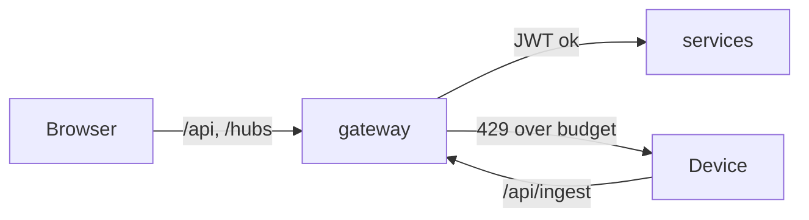
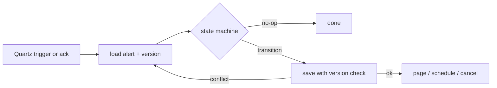

# Design patterns

Each pattern below exists because a concrete problem in remote monitoring needed it. Links point at the code that
implements it.

## API Gateway

**Problem.** The dashboard and thousands of devices shouldn't know where nine services live, each service shouldn't
re-implement rate limiting, and browsers need one origin for the refresh cookie and the WebSocket.

**Implementation.** [`src/gateway/RemoteHealthWatch.Gateway`](../src/gateway/RemoteHealthWatch.Gateway) runs YARP with routes and
clusters in [`appsettings.json`](../src/gateway/RemoteHealthWatch.Gateway/appsettings.json). Every route except `/api/auth/*`
and `/api/ingest/*` requires an authenticated JWT (validated here and again in each service). `/hubs/*` is forwarded as a
WebSocket to `realtime`. [`GatewayRateLimits.cs`](../src/gateway/RemoteHealthWatch.Gateway/RateLimiting/GatewayRateLimits.cs)
defines a token bucket per device key prefix and a fixed window per user.

**Trade-offs.** One more hop (about a millisecond locally) and a component every request depends on, which is why it
runs with two or three replicas in Kubernetes and holds no state.

## API Composition

**Problem.** The patient page needs demographics, latest vitals, 24h summaries, open alerts, the current NEWS2 score and
devices. Six round-trips from a browser over a hospital network is slow and leaks the service layout.

**Implementation.** [`OverviewController.cs`](../src/gateway/RemoteHealthWatch.Gateway/Composition/OverviewController.cs) serves
`GET /api/patients/{id}/overview`, starting all six calls at once with the caller's token
([`DownstreamClient.cs`](../src/gateway/RemoteHealthWatch.Gateway/Composition/DownstreamClient.cs)). The patient leg decides
access: a 403 or 404 there is returned as is and nothing else leaks. Any other leg that fails is reported in a
`degraded` list (and the `X-Composition-Degraded` header) while the rest of the page renders.

**Trade-offs.** The response is only as fast as the slowest leg, so every leg has a 2 s attempt timeout and 5 s total.
Partial responses push some handling into the UI.

## Database per Service

**Problem.** Shared tables couple deployments and let one service's query plan hurt another.

**Implementation.** [`deploy/sqlserver/init.sql`](../deploy/sqlserver/init.sql) creates `rhw_identity`, `rhw_patients`,
`rhw_devices`, `rhw_vitals`, `rhw_alerts`, `rhw_risk` and `rhw_insights`, each with its own login that owns only that
database. Each .NET service has its own `DbContext` and migrations (for example
[`VitalsDb.cs`](../src/services/vitals/RemoteHealthWatch.Vitals/Data/VitalsDb.cs)); the Python services use Alembic
([`risk-engine/alembic`](../src/services/risk-engine/alembic)). Redis holds hot read data for `vitals` and the SignalR
backplane, under separate key prefixes.

**Trade-offs.** No joins across services: the overview is composed, KPIs are rebuilt from events in insights, and the
care team is looked up over gRPC.

## Event Streaming / Partitioned Log

**Problem.** Readings for one patient must be processed in order (a late SpO2 must not overwrite a newer one, NEWS2 needs
the latest values), but the whole fleet must be processed in parallel.

**Implementation.** [`IngestionController.cs`](../src/services/devices/RemoteHealthWatch.Devices/Ingestion/IngestionController.cs)
produces to `devices.readings-raw` with `patientId` as the key; Kafka hashes the key to one of 12 partitions, and the
idempotent producer keeps per-partition order. Downstream, `vitals` republishes with the same key, so every consumer
sees one patient's history in order. The catalog is in [`deploy/kafka/topics.txt`](../deploy/kafka/topics.txt).

**Trade-offs.** A very busy patient can't be spread across consumers, which is fine at a few readings per second per
patient. Changing the partition count later would reshuffle keys, so it is sized up front.

## Competing Consumers

**Problem.** One `vitals` instance becomes the bottleneck when the fleet grows from 60 to 500 devices.

**Implementation.** Every `vitals` replica registers the same consumer group (`"vitals"` in
[`Program.cs`](../src/services/vitals/RemoteHealthWatch.Vitals/Program.cs));
[`KafkaConsumerHost.cs`](../src/shared/RemoteHealthWatch.ServiceDefaults/Messaging/KafkaConsumerHost.cs) uses the
cooperative-sticky assignor so a rebalance only moves the partitions it has to. With `--scale vitals=3` the 12
partitions split 4/4/4. In Kubernetes the HPA ([`hpa.yaml`](../deploy/k8s/base/hpa.yaml)) or the optional KEDA
lag scaler ([`keda-vitals-scaledobject.yaml`](../deploy/k8s/optional/keda-vitals-scaledobject.yaml)) adds replicas.

**Trade-offs.** More than 12 replicas would sit idle. During a rebalance a batch can be redelivered, which is why the
consumer must be idempotent (below).

## CQRS

**Problem.** The write side wants cheap appends of millions of small rows; the dashboard wants "latest value per vital"
and "hourly average for 30 days" without scanning raw data.

**Implementation.** The write model is an append-only table with a clustered columnstore index, partitioned by month
([migration](../src/services/vitals/RemoteHealthWatch.Vitals/Data/Migrations/20250425094500_InitialVitals.cs)).
[`ReadingProcessor.cs`](../src/services/vitals/RemoteHealthWatch.Vitals/Services/ReadingProcessor.cs) appends and then
[`RollupWriter.cs`](../src/services/vitals/RemoteHealthWatch.Vitals/Services/RollupWriter.cs) recomputes only the touched
1-minute and 1-hour buckets. [`SnapshotStore.cs`](../src/services/vitals/RemoteHealthWatch.Vitals/Services/SnapshotStore.cs)
keeps the latest value per vital in a Redis hash. Queries in
[`VitalsController.cs`](../src/services/vitals/RemoteHealthWatch.Vitals/Controllers/VitalsController.cs) read only those models:
24h trends from minute rollups, 7d/30d from hour rollups.

**Trade-offs.** Read models are eventually consistent (milliseconds here), and there are three places a value lives.
Rollups are recomputed rather than incremented so a replayed or late reading can't double count.

## Choreography-based Saga (enrollment)

**Problem.** Enrolling a patient touches patients (record), devices (pairing) and later the baseline. There is no
transaction across them, and pairing can fail.

**Implementation.** [`PatientService.EnrollAsync`](../src/services/patients/RemoteHealthWatch.Patients/Services/PatientService.cs)
publishes `patient-enrolled`.
[`devices/PatientEventsHandler.cs`](../src/services/devices/RemoteHealthWatch.Devices/Messaging/PatientEventsHandler.cs) pairs
the requested device or publishes `device-pairing-failed`.
[`patients/DeviceEventsHandler.cs`](../src/services/patients/RemoteHealthWatch.Patients/Messaging/DeviceEventsHandler.cs)
applies [`EnrollmentStateMachine.cs`](../src/services/patients/RemoteHealthWatch.Patients/Domain/EnrollmentStateMachine.cs),
and [`BaselineWatcher.cs`](../src/services/patients/RemoteHealthWatch.Patients/Services/BaselineWatcher.cs) completes the 24 h
baseline. Compensation: an unpaired last device sends the patient back to `PendingDevice`, and
[`alerts/DeviceHandler.cs`](../src/services/alerts/RemoteHealthWatch.Alerts/Messaging/DeviceHandler.cs) notifies the coordinator.

**Trade-offs.** The flow is spread across three services, which is why it is drawn in `how-it-works.md` and its state
machine is unit tested in one place.

## Orchestration-based Saga / Process Manager (escalation)

**Problem.** An unacknowledged critical alert must page nurse, then doctor, then coordinator on strict timers. A restart
must neither drop a pending escalation nor page someone twice, and an acknowledgement that lands at the same moment as a
timeout must win cleanly.

**Implementation.** [`EscalationStateMachine.cs`](../src/services/alerts/RemoteHealthWatch.Alerts/Escalation/EscalationStateMachine.cs)
is a pure state machine returning commands (notify, schedule, cancel, announce).
[`EscalationManager.cs`](../src/services/alerts/RemoteHealthWatch.Alerts/Escalation/EscalationManager.cs) loads the alert, applies
the transition, saves with an optimistic concurrency token, and only then runs side effects. Timers are Quartz triggers
in the SQL Server job store ([`EscalationScheduler.cs`](../src/services/alerts/RemoteHealthWatch.Alerts/Escalation/EscalationScheduler.cs),
schema in [`quartz-tables.sql`](../src/services/alerts/RemoteHealthWatch.Alerts/Data/Sql/quartz-tables.sql)), clustered across
replicas. Each trigger carries the level it was scheduled for, so a replayed trigger is a no-op.
[`EscalationRecovery.cs`](../src/services/alerts/RemoteHealthWatch.Alerts/Escalation/EscalationRecovery.cs) sweeps for overdue
alerts in case a process died between committing the alert and scheduling its trigger.

**Trade-offs.** Two mechanisms (Quartz and the sweep) for one job, accepted because each covers the other's failure
mode. Tests cover the restart and the race
([`EscalationManagerTests.cs`](../tests/RemoteHealthWatch.Alerts.Tests/EscalationManagerTests.cs)).

## Transactional Outbox + Idempotent Consumer

**Problem.** "Save, then publish" loses events when the process dies in between; "publish, then save" announces things
that never happened. Kafka delivers at least once, so consumers see duplicates.

**Implementation.** [`EventOutbox.cs`](../src/shared/RemoteHealthWatch.ServiceDefaults/Messaging/EventOutbox.cs) stages events in
the service's own `Outbox` table inside the business transaction;
[`OutboxDispatcher.cs`](../src/shared/RemoteHealthWatch.ServiceDefaults/Messaging/OutboxDispatcher.cs) relays them, using
`UPDLOCK, READPAST` so replicas share the work. Used by patients, devices, vitals and alerts; the Python services have
the same pair in [`kafka_io.py`](../src/services/risk-engine/app/kafka_io.py). Consumers record handled event ids in
`ProcessedEvents` in the same transaction ([`IdempotentRunner.cs`](../src/shared/RemoteHealthWatch.ServiceDefaults/Messaging/IdempotentRunner.cs));
realtime, which has no database, uses a Redis marker
([`RedisIdempotentRunner.cs`](../src/services/realtime/RemoteHealthWatch.Realtime/Messaging/RedisIdempotentRunner.cs)).
Readings get a second, finer guard: [`ReadingDeduplicator.cs`](../src/services/vitals/RemoteHealthWatch.Vitals/Domain/ReadingDeduplicator.cs)
drops repeated `(deviceId, seq)` pairs, backed by a unique rowstore key table.

**Trade-offs.** Extra tables and a polling relay (250 ms idle poll). Side effects that can't be rolled back (emails,
Quartz) are deferred until after commit with
[`PostCommitActions.cs`](../src/shared/RemoteHealthWatch.ServiceDefaults/Messaging/PostCommitActions.cs).

## Throttling / Rate Limiting

**Problem.** A device with a bug, or one flushing hours of buffer, shouldn't starve the rest of the fleet.

**Implementation.** Two token buckets keyed by the device key prefix: one at the gateway
([`GatewayRateLimits.cs`](../src/gateway/RemoteHealthWatch.Gateway/RateLimiting/GatewayRateLimits.cs), 30 tokens, +6 per 5 s)
and one in devices ([`Program.cs`](../src/services/devices/RemoteHealthWatch.Devices/Program.cs), configurable under
`Ingestion:RateLimit`). Rejected batches get `429` with `Retry-After`; the simulator keeps them in its buffer and retries.
Logins are limited per client address in identity.

**Trade-offs.** Token buckets allow bursts by design; the bucket size is the burst a reconnecting device may send.

## Circuit Breaker + Retry + Timeout

**Problem.** A slow patients service shouldn't hold every alerts thread hostage.

**Implementation.** Every outbound client uses `Microsoft.Extensions.Http.Resilience`: the gRPC directory client in
[`AccessExtensions.cs`](../src/shared/RemoteHealthWatch.ServiceDefaults/Access/AccessExtensions.cs) (2 s attempt timeout,
retries on transport errors, circuit breaker), the devices → patients REST client, the alerts → identity client and the
composition clients in the gateway. The Python services wrap their patients calls in a small retry loop with timeouts
([`auth.py`](../src/services/risk-engine/app/auth.py)). A message whose handler still fails goes to the retry topic
(below), not into a hot loop.

**Trade-offs.** Retries add load on a struggling dependency; the breaker and short timeouts bound that.

## Cache-Aside

**Problem.** Threshold evaluation runs on every reading; asking patients for limits each time would make it the
bottleneck.

**Implementation.** [`CareTeamDirectory.cs`](../src/services/alerts/RemoteHealthWatch.Alerts/Services/CareTeamDirectory.cs) reads
thresholds and care teams through HybridCache (in-process L1 + Redis L2), filling from gRPC on a miss.
[`alerts/PatientHandler.cs`](../src/services/alerts/RemoteHealthWatch.Alerts/Messaging/PatientHandler.cs) evicts on
`thresholds-changed` and `care-team-changed`. Realtime caches each user's visible patients the same way
([`PatientAccess.cs`](../src/shared/RemoteHealthWatch.ServiceDefaults/Access/PatientAccess.cs)) and drops them by tag on
care-team changes; devices caches key lookups
([`DeviceAuthCache.cs`](../src/services/devices/RemoteHealthWatch.Devices/Ingestion/DeviceAuthCache.cs)).

**Trade-offs.** Another replica's L1 can serve a stale entry until it expires (1 to 5 minutes, 15 s for device keys).
A changed threshold therefore applies within minutes, not instantly, on multi-replica deployments.

## Claim Check

**Problem.** Weekly PDFs are tens to hundreds of kilobytes; putting them on Kafka bloats the log and every consumer.

**Implementation.** [`reports.py`](../src/services/insights/app/reports.py) writes the PDF to blob storage (Azurite
locally) and publishes `insights.report-generated` carrying only the container, blob name and ids. The PDF is fetched on
demand through `GET /api/insights/reports/{id}/pdf`, which checks care-team access first.

**Trade-offs.** Two systems to keep consistent: the blob is written before the index row and event, so an orphaned blob
is possible, a dangling event is not.

## Retry Topic + Dead Letter Topic

**Problem.** A poison message (or a dependency outage) must not block a partition, and must not be silently dropped.

**Implementation.** On failure [`KafkaConsumerHost.cs`](../src/shared/RemoteHealthWatch.ServiceDefaults/Messaging/KafkaConsumerHost.cs)
republishes the message to `{topic}.retry` with `x-attempt` and an exponential `x-not-before`; a second consumer per
handler drains the retry lane. After four attempts the message goes to `{topic}.dlq` with the last error in `x-error`.
Unreadable payloads go straight to the DLQ. Kafka UI (`http://localhost:8085`) shows the DLQ topics.

**Trade-offs.** A retried message can overtake later messages for the same patient. Handlers are written to tolerate
that (newest-wins snapshots, recomputed rollups).

## Distributed Tracing

**Problem.** "Why did this alert arrive 20 seconds late?" spans six processes and a broker.

**Implementation.** [`TelemetryExtensions.cs`](../src/shared/RemoteHealthWatch.ServiceDefaults/TelemetryExtensions.cs) wires
OpenTelemetry for ASP.NET Core, HttpClient (including gRPC) and the custom `RemoteHealthWatch.Messaging` source; the producer
writes `traceparent` into Kafka headers and the consumer host continues the trace. The Python services do the same
([`telemetry.py`](../src/services/risk-engine/app/telemetry.py)). Traces go to Jaeger (`http://localhost:16686`). Query
strings are stripped from spans; only surrogate ids appear. Custom meters: `rhw.ingestion.readings`,
`rhw.vitals.ingestion.lag`, `rhw.alerts.raised`, `rhw.alerts.time_to_ack`, `rhw.realtime.push.lag`, `rhw.messaging.event.lag`.

**Trade-offs.** Jaeger all-in-one keeps traces in memory; production would point the exporter at a collector.

## Health Check API

**Problem.** Kubernetes and compose need to know the difference between "process alive" and "ready for traffic".

**Implementation.** [`ServiceDefaultsExtensions.cs`](../src/shared/RemoteHealthWatch.ServiceDefaults/ServiceDefaultsExtensions.cs)
maps `/alive` (process only) and `/health` (SQL Server, Redis, Kafka as registered by each service). The Python services
expose the same two endpoints, insights also checking Azurite. Deployments use `/alive` for startup and liveness probes,
`/health` for readiness.

**Trade-offs.** Readiness that includes Kafka takes a pod out of rotation during a broker blip, which is what we want for
consumers and acceptable for the APIs.

## Externalized Configuration

**Problem.** The same image must run in compose, a dev cluster and AKS.

**Implementation.** Everything environment-specific is configuration: `appsettings.json` defaults, environment variables
in [`docker-compose.yml`](../deploy/docker-compose.yml), and a ConfigMap plus Secret in Kubernetes
([`configmap.yaml`](../deploy/k8s/base/configmap.yaml), [`secrets.env.example`](../deploy/k8s/base/secrets.env.example)),
patched per overlay. Python services read `RISK_*` / `INSIGHTS_*` variables through pydantic-settings
([`config.py`](../src/services/risk-engine/app/config.py)). Only placeholders are committed; `.env` is git-ignored.

**Trade-offs.** Configuration errors show up at startup rather than build time; the JWT key length is checked on boot for
that reason.
