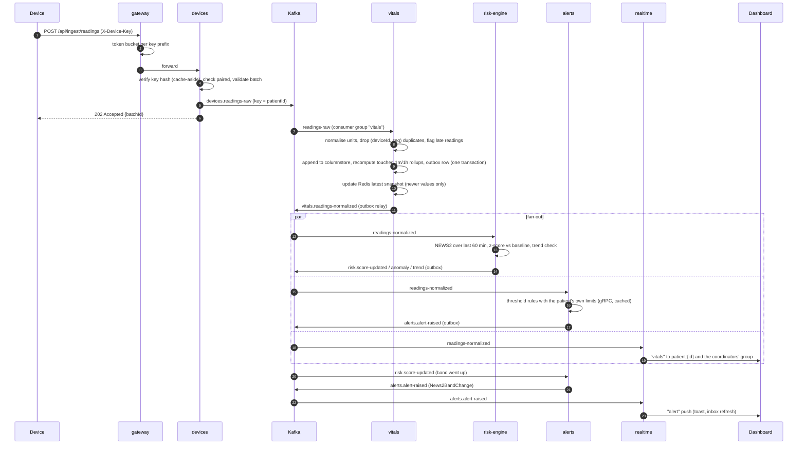
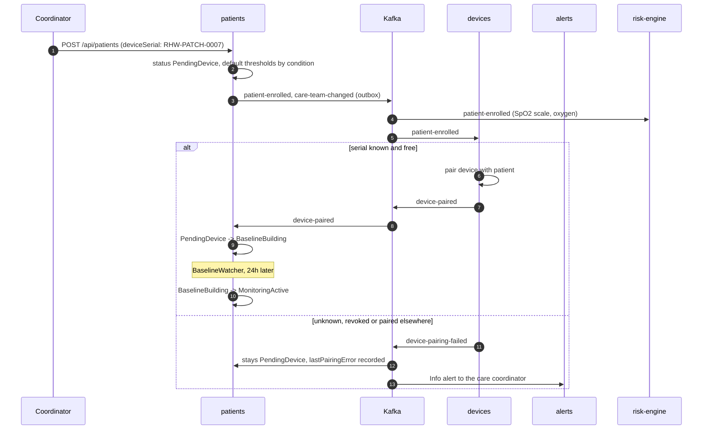
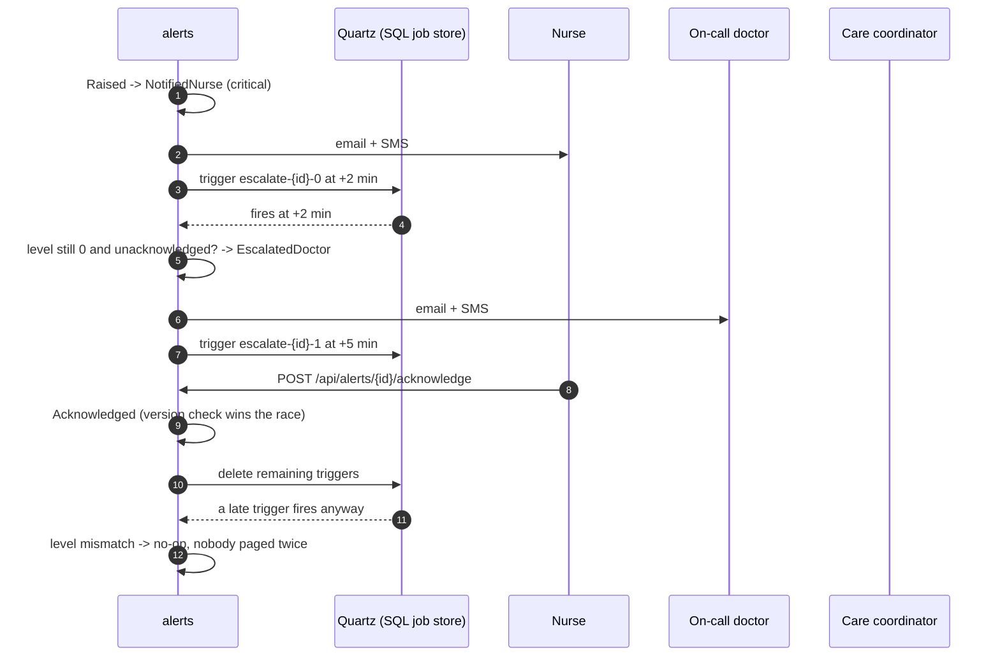
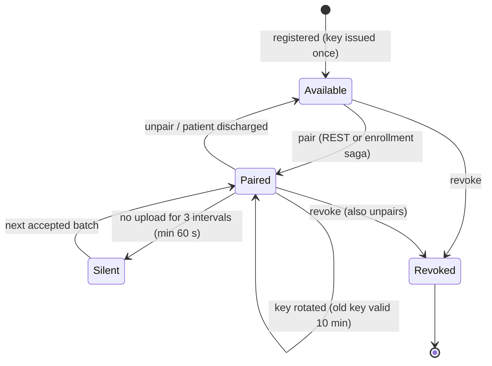
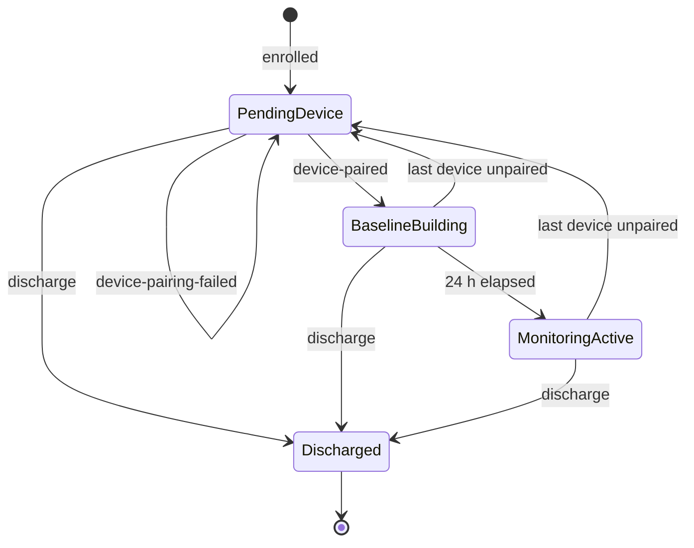
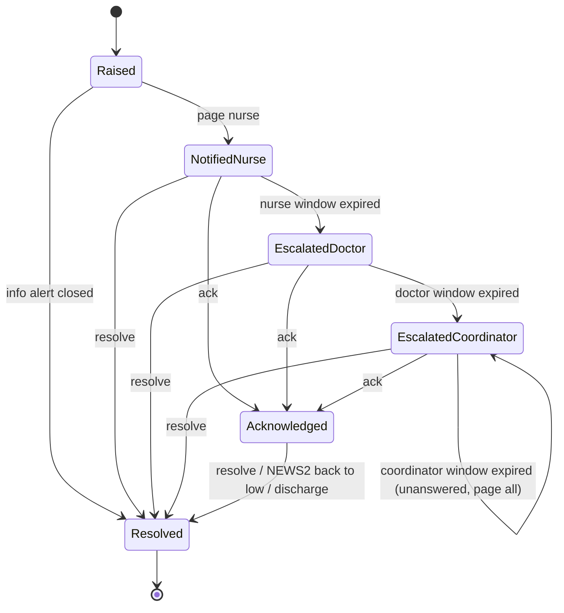

# How it works

This walks through the three flows that matter most: a reading travelling from a device to the dashboard, a patient
being enrolled, and an unacknowledged alert escalating. State diagrams for devices, enrollment and alerts follow.

## From device to dashboard

A wearable patch uploads a batch every few seconds. The batch carries a per-device sequence number on every reading
and the device's own timestamp.



What the dashboard shows is therefore a few hundred milliseconds behind the device. Locally, with 60 simulated devices,
alert events reached the browser about 40 ms after they were created (`docs/streaming-and-scaling.md` has the numbers).

### Example ingestion batch

```http
POST /api/ingest/readings
X-Device-Key: rhwd_3f9a1c2e_N7m...redacted...Q
Content-Type: application/json

{
  "batteryPercent": 81,
  "readings": [
    { "seq": 1749719400001, "vital": "HeartRate", "value": 88, "unit": "bpm", "measuredAt": "2025-06-12T09:10:00Z" },
    { "seq": 1749719400002, "vital": "SpO2", "value": 0.94, "unit": "fraction", "measuredAt": "2025-06-12T09:10:00Z" },
    { "seq": 1749719400003, "vital": "BloodPressure", "value": 132, "value2": 84, "unit": "mmHg", "measuredAt": "2025-06-12T09:10:00Z" }
  ]
}
```

`SpO2` arrives as a fraction here; vitals stores 94 %. Temperature in °F, glucose in mmol/L and blood pressure in kPa are
converted the same way (`src/services/vitals/RemoteHealthWatch.Vitals/Domain/UnitNormalizer.cs`).

## Enrollment (choreography saga)

No service orchestrates enrollment. Each step is a reaction to the previous step's event, and the patient's status in
`patients` is the saga state.



### Compensation

If the last device is later unpaired (by a coordinator, or because it was revoked), `devices` publishes
`device-unpaired`; `patients` moves the patient back to `PendingDevice` and clears the baseline, and `alerts` raises an
Info alert for the coordinator. Discharging publishes `patient-discharged`, which unpairs every device (devices),
resolves every open alert (alerts) and stops scoring (risk-engine).

The demo seed enrolls one patient, "Orla Pending", with a serial that doesn't exist, so the failure path is visible
from the first minute.

## Alert escalation (orchestration / process manager)

Escalation is driven by one component that owns the alert's state: `EscalationManager` in alerts. Timeouts are Quartz
triggers stored in SQL Server, so they survive restarts and fire on exactly one replica.



| Severity | Nurse window | Doctor window | Coordinator window |
|---|---|---|---|
| Critical | 2 min | 5 min | 10 min |
| High | 5 min | 15 min | 30 min |
| Medium | 15 min | 30 min | 60 min |
| Low | 30 min | 60 min | 120 min |
| Info | goes straight to the coordinator, never escalates | | |

When the coordinator window also expires the alert is marked unanswered and everyone on the care team is paged once
more; the clock then stops.

## State diagrams

### Device



`Silent` is a flag on a paired device (`SilentSince`), not a separate status column.

### Enrollment



Readings are scored and checked against thresholds from the moment a device is paired; `BaselineBuilding` only means
the anomaly detector doesn't yet have a full day to compare against.

### Alert



While an alert is open, the same problem (same patient, type and metric) increments its occurrence count rather than
raising a new alert; a worse reading upgrades its severity and tightens the clock. After it is resolved, the same
problem at the same or lower severity is suppressed for a window (5 to 60 minutes by severity).
