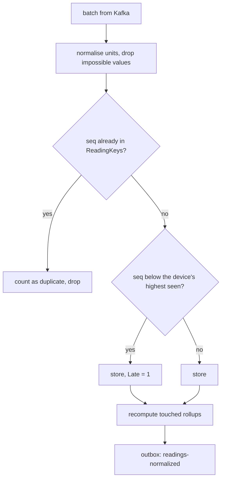

# Streaming and scaling

## Partitioning

Readings enter Kafka on `devices.readings-raw` keyed by the surrogate `patientId`. Kafka hashes the key to one of
**12 partitions**, so:

- every batch for one patient lands on the same partition and is consumed in order,
- up to 12 consumers in a group can work in parallel,
- the key is a GUID, never an MRN or name, so the log contains no PHI.

`vitals` republishes on `vitals.readings-normalized` with the same key and 12 partitions, so every downstream consumer
(risk-engine, alerts, realtime, insights) also sees one patient's readings in order. Lower-volume topics use 6
partitions; the report topic 3. See the catalog in `architecture.md`.

## Ordering guarantees

| Where | Guarantee | How |
|---|---|---|
| Device → devices | none | devices resend after reconnects; batches can arrive in any order |
| devices → Kafka | per patient, per partition | idempotent producer, `acks=all`, keyed by patient |
| Kafka → vitals | per partition | one consumer per partition in the group; offsets stored only after the handler commits |
| vitals → Kafka | per patient | outbox relayed in `OccurredAt` order |
| Retry lane | **not** ordered relative to the main lane | a retried batch can arrive after newer ones |

Because device order is never guaranteed, correctness doesn't depend on it:

- the Redis snapshot only accepts a value with a newer device timestamp,
- rollups are recomputed from stored rows rather than incremented,
- NEWS2 picks the newest observation by device timestamp,
- alerts ignore readings more than 15 minutes old.

## Duplicates and out-of-order readings

Devices keep a monotonic sequence number per reading (the simulator starts from the epoch millisecond so it survives
restarts). On reconnect a device sends its buffered readings and, because the last acknowledgement may have been lost,
often repeats the last batch.



`ReadingKeys` is a rowstore table with a primary key on `(DeviceId, Seq)`. The columnstore can't enforce that key
itself: every index on a partitioned columnstore must include the partition column (`MeasuredAt`). The batch's event id
is also recorded in `ProcessedEvents`, so a redelivered batch is skipped before any of this runs.

Observed locally: after the dropout scenario's devices reconnected, **468 buffered readings were stored and flagged
late and the re-sent batch produced 0 duplicate rows**; across ~30,000 stored readings there were 0 duplicate
`(DeviceId, Seq)` pairs, including through a rebalance from 1 to 3 `vitals` replicas.

## Back-pressure and rate limits

- **At the edge.** Two token buckets per device key prefix: gateway (30 tokens, +6 per 5 s) and devices (20 tokens, +5
  per 5 s, configurable). A device sending one batch every 5 s uses a fifth of its budget; a reconnecting device can
  burst its buffer. Over budget it gets `429` with `Retry-After` and keeps the batch.
- **Validation.** At most 500 readings per batch; readings more than 2 minutes in the future or 7 days in the past are
  rejected.
- **Kafka as the buffer.** The ingestion endpoint returns as soon as the batch is on Kafka. If vitals falls behind,
  the lag grows on the topic (3 days retention) rather than the devices seeing errors.
- **Consumers pull.** Each consumer processes a message, stores the offset, then polls again, so a slow handler slows
  its own partition only.

## Consumer-group scaling

All `vitals` replicas share the group `vitals`; the cooperative-sticky assignor rebalances incrementally.

```bash
docker compose up -d --scale vitals=3 --no-recreate vitals
docker compose exec kafka /opt/kafka/bin/kafka-consumer-groups.sh --bootstrap-server localhost:9092 --describe --group vitals
```

Measured locally after scaling from 1 to 3 replicas:

| Replica | Partitions of `devices.readings-raw` |
|---|---|
| vitals-1 | 8, 9, 10, 11 |
| vitals-2 | 0, 2, 4, 6 |
| vitals-3 | 1, 3, 5, 7 |

Total lag right after the rebalance: 4 messages. In Kubernetes, the HPA scales `vitals` between 2 and 12 replicas on
CPU; the optional KEDA ScaledObject scales on consumer lag (500 messages per replica) instead. Twelve is the ceiling
because the topic has 12 partitions.

Other services scale the same way: alerts, realtime, risk-engine and insights each use one consumer group per handler,
and the outbox relays use `UPDLOCK, READPAST` so several replicas can share an outbox without double-publishing.
Alerts replicas share one Quartz cluster, so an escalation timer fires on exactly one of them.

## Measured throughput

Local run on a laptop (Docker Desktop, Apple silicon, SQL Server running under amd64 emulation), all services in
compose, 3 `vitals` replicas:

| Load | Accepted by ingestion | Stored by vitals (from rollups) | Consumer lag |
|---|---|---|---|
| 60 devices every 5 s (default) | ~50 readings/s | ~50 readings/s | under 100 messages on every group |
| + a second simulator, 60 devices every 2 s | ~170 readings/s combined | 121 readings/s in the measured minute (second simulator alone, while the first was re-keying) | under 120 messages on every group |

A reading is a single vital (a patch batch carries 4 to 6). The SQL Server container is the bottleneck under emulation;
on native amd64 or Azure SQL the same code handles considerably more. Scale the simulator with:

```bash
SIM_DEVICES=60 SIM_INTERVAL_SECONDS=2 docker compose up -d device-sim
SEED_PATIENTS=500 SIM_DEVICES=500 docker compose up -d seed device-sim   # about 500 devices
```

## Latency

| Path | Measured |
|---|---|
| Alert event created → dashboard (SignalR push received in the browser) | ~40 ms (shown live in the dashboard toolbar) |
| Critical alert raised → nurse email in MailHog | median 10 ms, max 100 ms over 131 alerts |
| Unacknowledged critical alert → doctor paged | 2 min 0 s (Quartz trigger) |
| Device silent → alert | 60–80 s (3 missed 5 s intervals, 60 s minimum, 20 s sweep) |

Custom metrics for the same numbers are emitted as OpenTelemetry instruments: `rhw.vitals.ingestion.lag` (device
timestamp to stored), `rhw.messaging.event.lag` (event created to consumed, per topic and group) and
`rhw.realtime.push.lag` (event created to hub send).
